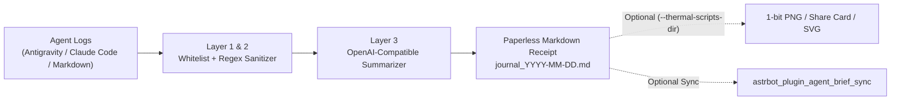

# Agent Progress Receipt Skill

Cross-agent daily progress visualization & **Paperless Receipt** generator for **Antigravity, Claude Code, OpenClaw, Cursor, and Markdown workflows**.



## Features

- **Paperless-First**: Outputs `journal_YYYY-MM-DD.md` with YAML frontmatter, focus score, streak counter (`DAY #N`), domain progress bars, `[x]` achievements, and `[ ]` next anchor.
- **Zero-Quota Friendly**: Point `config.json` at any local or free OpenAI-compatible endpoint (Ollama, AIStudio2API, SiliconFlow, etc.) and schedule via OS cron / Task Scheduler.
- **4-Layer Privacy Firewall**: Strips tool outputs, redacts API keys/PII/home paths deterministically before any LLM call, and post-sanitizes output.
- **Graceful Degradation**: Works anywhere with pure Python standard library in `--md-only` mode; optionally renders thermal receipt images if `note_artisan` + `Pillow` are available.

## Quickstart

```bash
cp config.example.json config.json
python scripts/generate_receipt.py --config config.json --today --md-only
```

## Adapters

| Adapter | Flag | Default Source |
| :--- | :--- | :--- |
| Antigravity | `--adapter antigravity` | `~/.gemini/antigravity/brain/*/.system_generated/logs/transcript.jsonl` |
| Claude Code | `--adapter claude_code` | `~/.claude/projects/*/*.jsonl` |
| Markdown / OpenClaw | `--adapter markdown` | `./logs/*.md` (or `--source` glob) |

## Pairing with AstrBot

Use [astrbot_plugin_agent_brief_sync](https://github.com/xianhan2019-source/astrbot_plugin_agent_brief_sync) to silently inject your sanitized brief into private IM chats only and fetch `/today_card` on demand.
